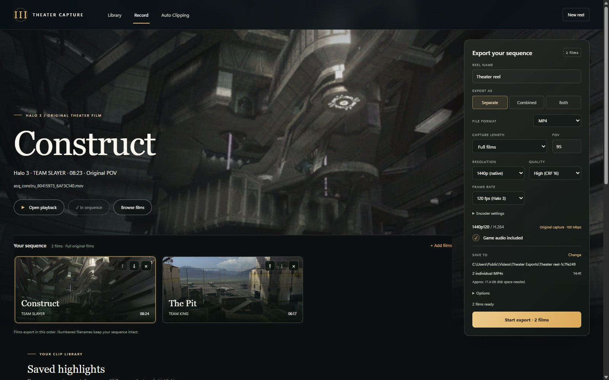
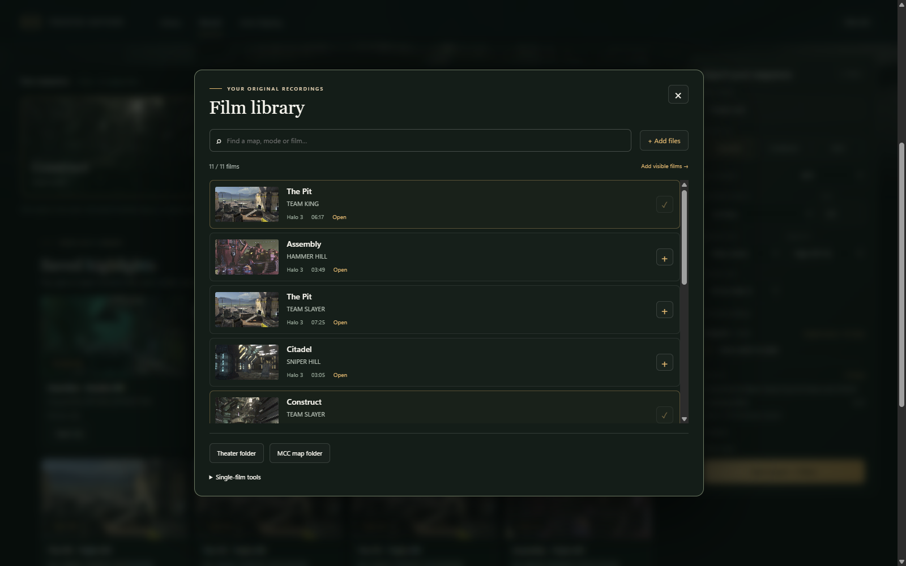
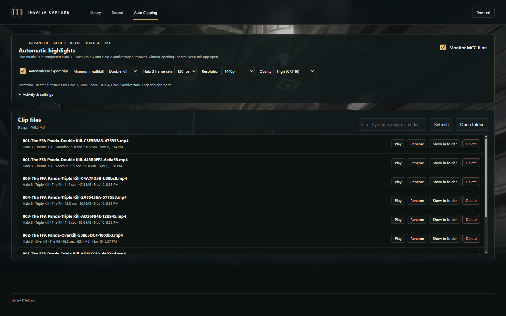

# MCC Theater Capture

Play and export MCC Theater films from Halo 3, Halo: Reach, Halo 4, and Halo 2 Anniversary multiplayer. Export full matches or multikill highlights as MP4 or MOV with game audio.

Halo 3 full-match and sample exports support 60 or 120 fps. Other games and multikill highlights export at 60 fps.

Requires Windows x64, an installed copy of MCC with the matching game content, and original Theater films. Only supported MCC engine builds work; game files are not included.

Extract the complete release ZIP and open `MCCTheaterCapture.exe`. Add films from **Library**, arrange the sequence on **Record**, choose export settings, and click **Start export**. Keep the app open until the export finishes.

Browse your Theater films and add them to the sequence from the library.

Turn on **Monitor MCC films** on the **Auto Clipping** tab to preserve completed Halo 3, Reach, Halo 4 and Halo 2 Anniversary autosaves and find Double Kills or better without opening Theater. Check **Automatically export clips** to make MP4 clips at your chosen resolution and quality with game audio in the background as soon as each film is scanned, even while MCC is still open. Keep the app open; monitoring and unfinished exports resume when you reopen it. Use **Activity & settings** to review results, export individual matches, change the minimum multikill or open saved films. The minimum applies to newly discovered films; exports include three seconds before and after each multikill.

Monitoring includes current autosaves for every supported title and Movie files written since it was first enabled. It preserves original bytes in `UserData/Monitoring`, deduplicates identical copies, and keeps its queue separate from your manual sequence. It stops ingesting at 20 GB of archived films or when less than 1 GB would remain free; use **Saved films** to free space. Keep source films for pending exports. Reach, Halo 4 and H2A scans need the MCC map folder to be set. Use **Clip files** to play, rename or delete exported clips.

Monitoring regression checks: `dotnet run --project tests/Monitoring/MonitoringTests.csproj -c Release`.

Standalone packages include .NET, WebView2, FFmpeg, and FFprobe. Keep the extracted folder together. Recordings, settings, and caches created under `UserData` are personal and should not be shared with the app.

See [Build](docs/BUILD.md) for source builds and packaging. Third-party notices are in `deps/` and `native/THIRD_PARTY_LICENSES.txt`; packaged notices are in `licenses/`.
