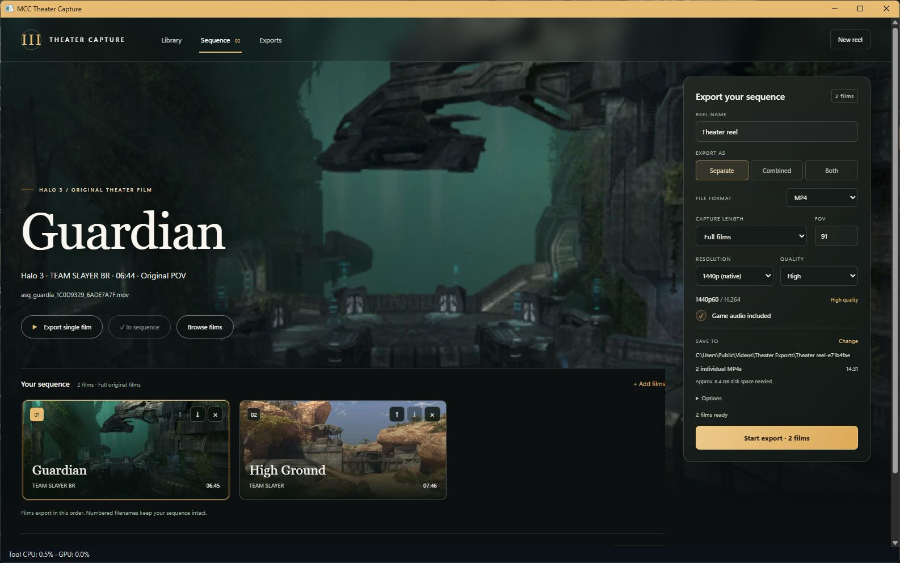

# MCC Theater Capture

Play and export MCC Theater films from Halo 3, Halo: Reach, Halo 4, and Halo 2 Anniversary multiplayer. Export full matches or multikill highlights as MP4 or MOV with game audio.

Halo 3 full-match and sample exports support 60 or 120 fps. Other games and multikill highlights export at 60 fps.

Requires Windows x64, an installed copy of MCC with the matching game content, and original Theater films. Only supported MCC engine builds work; game files are not included.

Extract the complete release ZIP and open `MCCTheaterCapture.exe`. Add films to **Library**, arrange the sequence, choose export settings, and click **Start export**. Keep the app open until the export finishes.

Browse your Theater films and add them to the sequence from the library.

Standalone packages include .NET, WebView2, FFmpeg, and FFprobe. Keep the extracted folder together. Recordings, settings, and caches created under `UserData` are personal and should not be shared with the app.

See [Build](docs/BUILD.md) for source builds and packaging. Third-party notices are in `deps/` and `native/THIRD_PARTY_LICENSES.txt`; packaged notices are in `licenses/`.
